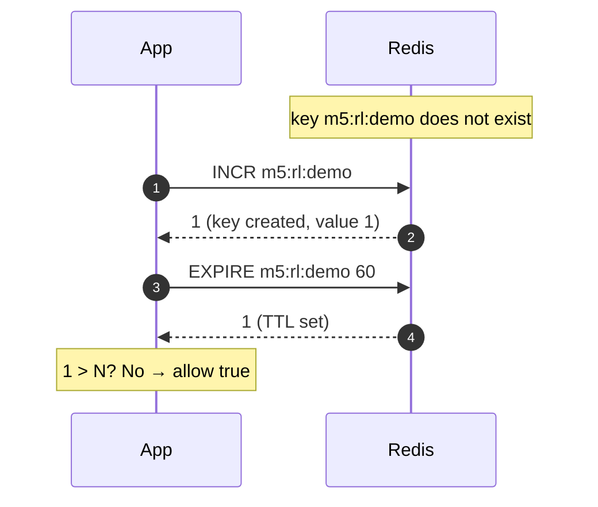
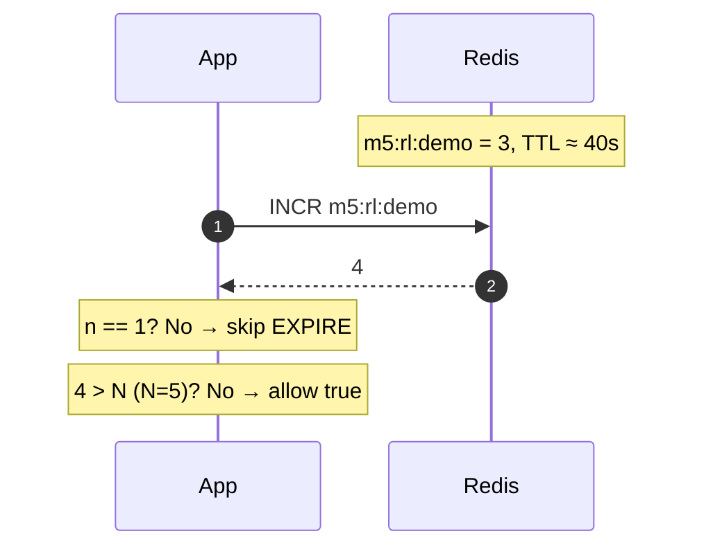
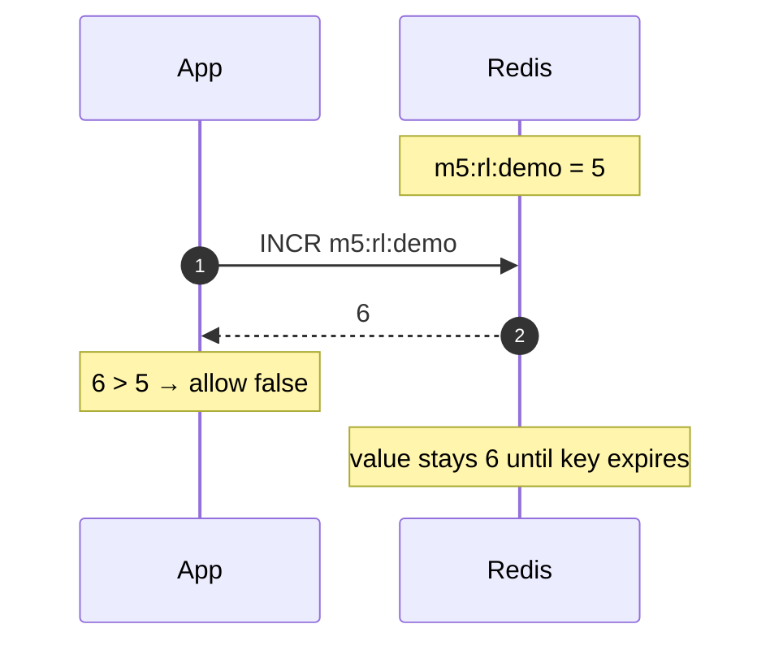
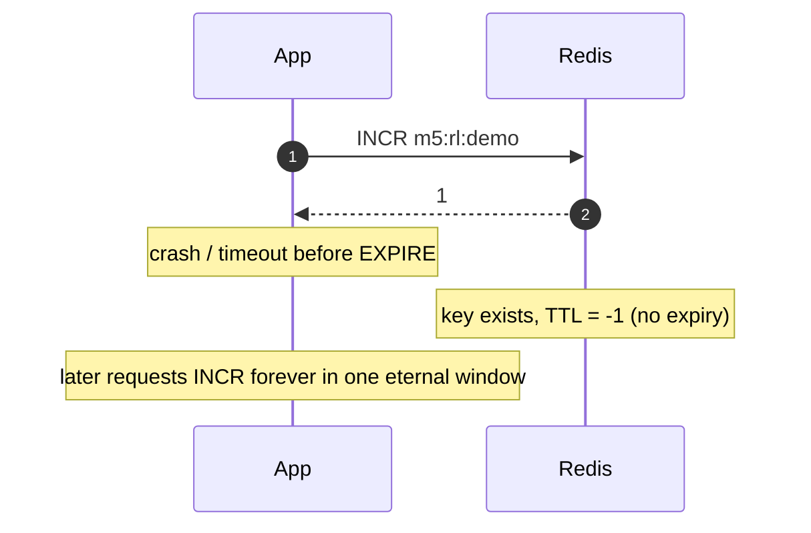
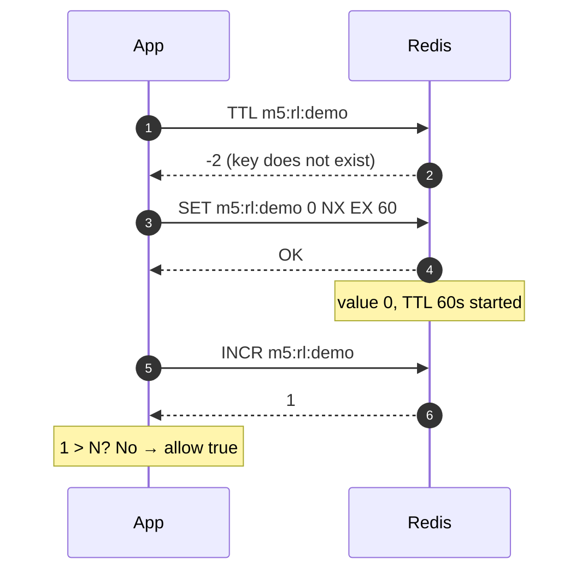
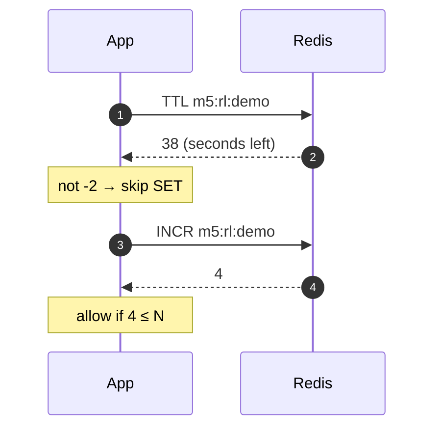
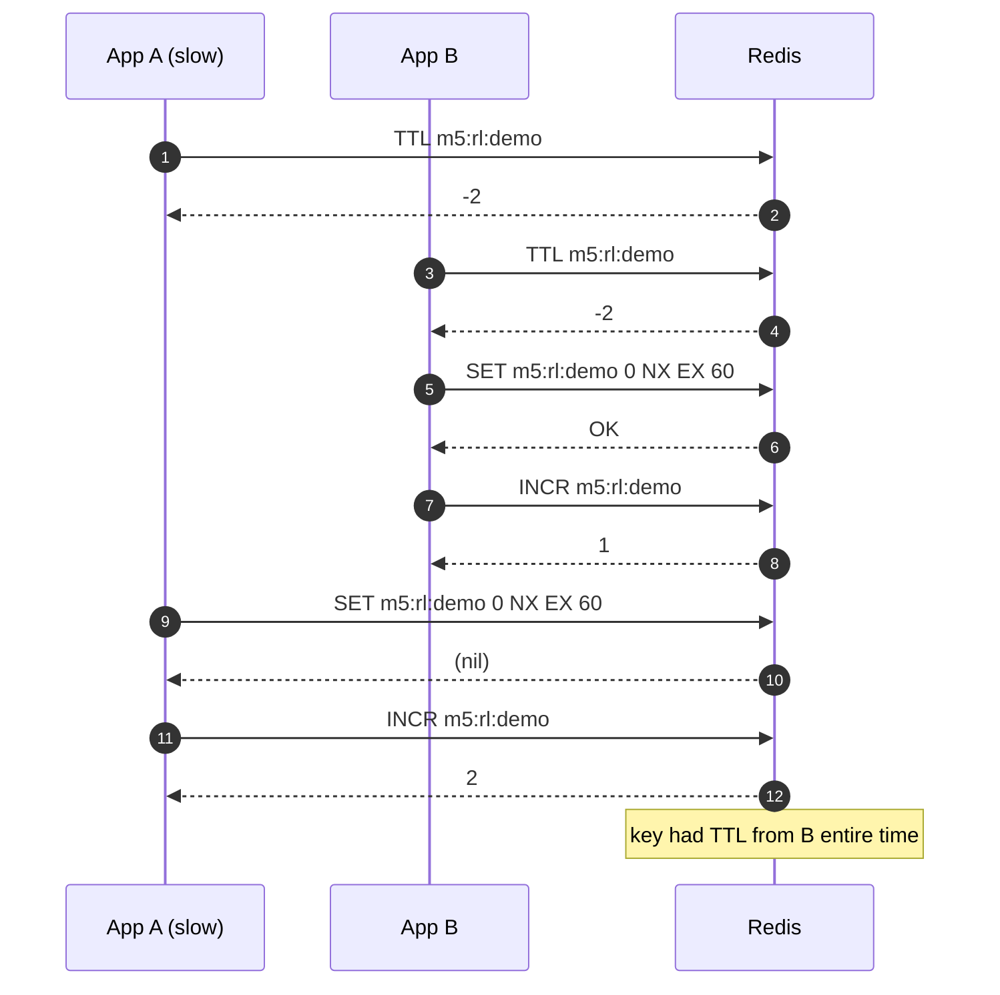
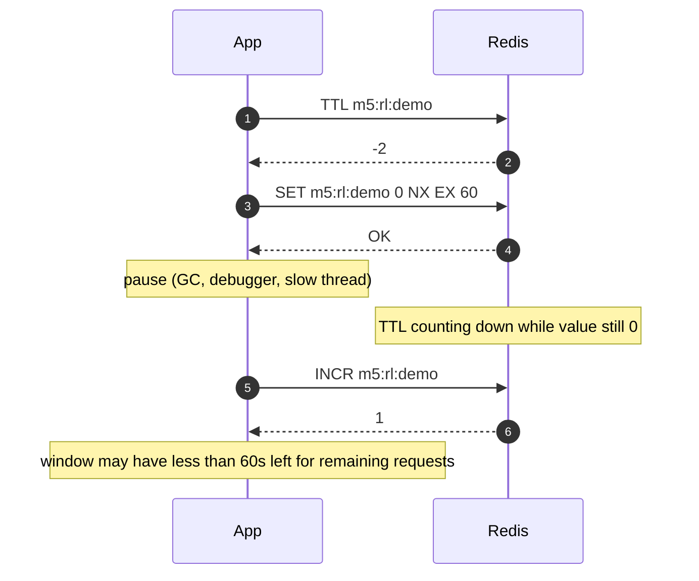

# Lab 5 — Rate limit approaches and failure modes

Reference for **fixed-window** rate limiting in Redis (Module 5). Complements [`README.md`](README.md); does not replace implementing `lab_5_rate_limit.py`.

**Key pattern:** `m5:rl:{api_key}` — hash or encode untrusted keys if needed.

**Semantics (Lab 5):** At most **N** allowed checks per **60-second fixed window** per API key. `allow()` returns `True` or `False`.

---

## How Redis runs commands (context for every approach)

- Many clients can **send** at the same time; Redis (single instance) **executes one command at a time** — serial, not parallel.
- **Interleaving** means another client’s commands can run **between your separate round trips** (or between separate batches), unless you use one atomic command, `MULTI`/`EXEC`, or Lua.
- **Pipeline** reduces RTT; it does **not** by itself stop other clients between your **next** `execute()` call.

---

## Approach A — `INCR` + `EXPIRE` on first hit (classic fixed window)

**Sketch:**

```text
n = INCR m5:rl:{key}
if n == 1:
    EXPIRE m5:rl:{key} 60
if n > N:
    return false
return true
```

| Pros | Cons |
|------|------|
| One main code path, few branches | `INCR` and `EXPIRE` are two commands unless pipelined/Lua |
| Window clock starts on **first counted request** | Fixed-window **boundary burst** (see below) |
| Easy to read and test | Denied requests still increment if you `INCR` before check |

**What is atomic:** Each `INCR` and each `EXPIRE` alone. The **pair** is not one atomic unit unless batched or scripted.

### Failure modes (A)

| Failure | How it happens | Symptom |
|---------|----------------|---------|
| **Key without TTL (`TTL == -1`)** | App crashes after `INCR`, before `EXPIRE`; or old bug/deploy only used `INCR` | Counter never resets; permanent throttle |
| **Brief no-TTL window** | Gap between `INCR` (creates key) and `EXPIRE` | Usually fixed when `EXPIRE` runs; worst case crash → `-1` |
| **Both clients see `n == 1`** | Two concurrent `INCR`s → `1` and `2`; both may call `EXPIRE` | Usually OK (same 60s); not a bypass |
| **Over-limit counter** | Check after `INCR`: 6th request does `INCR` → 6 then deny | Redis value can exceed N until key expires |
| **Boundary burst** | Window resets at key expiry | Up to **2N** requests across two adjacent windows in a short span (fixed-window artifact) |

**Mitigations (notes / stretch):** Pipeline `INCR` + conditional `EXPIRE` in app; **Lua** for one atomic script; defensive `if TTL == -1: EXPIRE` only for ops/debug recovery.

### Sequence diagrams (Approach A)

**A1 — First request in a new window (happy path)**



**A2 — Later request in the same window**



**A3 — Over limit (N = 5)**



**A4 — Gap between INCR and EXPIRE (failure: crash or slow app)**



**A5 — Two clients, cold start (both increment; both may EXPIRE)**

```mermaid
sequenceDiagram
    autonumber
    participant AppA as App A
    participant AppB as App B
    participant Redis

    Note over Redis: key missing

    AppA->>Redis: INCR m5:rl:demo
    Redis-->>AppA: 1

    AppB->>Redis: INCR m5:rl:demo
    Redis-->>AppB: 2

    AppA->>Redis: EXPIRE m5:rl:demo 60
    Redis-->>AppA: 1

    AppB->>Redis: EXPIRE m5:rl:demo 60
    Redis-->>AppB: 1

    Note over AppA,AppB: Both allowed; count is 2; TTL set (usually OK)
```

### Optimizing Approach A (pipeline, `MULTI`/`EXEC`, Lua)

**Goals:**

| Goal | Why |
|------|-----|
| Fewer **round trips (RTT)** | `INCR` + conditional `EXPIRE` is 2 trips on the first hit in a window |
| Shorter **no-TTL gap** | After `INCR` creates the key, `EXPIRE` should follow immediately (crash safety) |
| **Conditional `EXPIRE`** | Only when `n == 1` — fixed window must **not** reset TTL on every request |

**Baseline (no optimization):**

```text
n = INCR key                    # RTT 1
if n == 1: EXPIRE key 60        # RTT 2 (first hit only)
return n <= N
```

Steady state: **1 RTT** per `allow()`. New window: **2 RTT**.

---

#### 1. Pipeline (non-transactional) — RTT only

Queue commands, one `execute()` per batch. You **cannot** know whether to queue `EXPIRE` until you see the `INCR` reply, so use **two batches** on the cold path:

```text
# Batch 1
pipe.incr(key)
n = pipe.execute()[0]           # 1 RTT

# Batch 2 — only if n == 1
if n == 1:
    pipe.expire(key, 60)
    pipe.execute()              # +1 RTT on first hit only
```

| Fixes | Does not fix |
|-------|----------------|
| Same RTT count as baseline (still 1 or 2 trips) | Gap between batch 1 and 2 — another client can `INCR` between them (usually OK for counting) |
| Slightly cleaner client code if you add more commands to batch 2 | Crash **after** batch 1, before batch 2 → still risk `TTL == -1` |

**Do not** pipeline `INCR` + `EXPIRE` on **every** request unless you **want** to refresh TTL each time (that turns the limit into “60s since **last** request,” not a fixed window from first hit).

---

#### 2. `MULTI` / `EXEC` — atomic batch, not conditional logic

Transactional pipeline groups commands so no **other client** interleaves **inside** the block:

```python
pipe = client.pipeline(transaction=True)
pipe.multi()
pipe.incr(key)
pipe.expire(key, 60)   # ← runs on EVERY allow() if you always queue it
pipe.execute()
```

| If you always `INCR` + `EXPIRE` in one `EXEC` | Effect |
|-----------------------------------------------|--------|
| Every request resets TTL to 60s | **Wrong** for classic fixed window (window slides with traffic) |
| Atomic | No gap between `INCR` and `EXPIRE` **within** that request |

`MULTI`/`EXEC` does **not** let you branch on the `INCR` result **inside** the same transaction without Lua. You cannot `INCR`, read `1`, then queue `EXPIRE` in one `EXEC` from plain redis-py without the script.

**Valid `MULTI` use for Approach A:** only if you split into **two** transactions (same as baseline) — e.g. `EXEC` with just `INCR`, then decide `EXPIRE` — which does not beat Lua for gap + RTT.

```text
MULTI
INCR key
EXEC          → read n in app
# if n == 1: second MULTI/EXEC with EXPIRE — still 2 RTTs, smaller inter-client gap only on the EXPIRE trip if you MULTI that alone (pointless for one command)
```

---

#### 3. Lua (`EVAL`) — best fit for Approach A

One server-side script: **`INCR` → if `n == 1` then `EXPIRE` → return allow/deny**. One RTT, no app gap between `INCR` and `EXPIRE`, conditional TTL preserved.

```lua
-- KEYS[1] = m5:rl:{key}, ARGV[1] = limit N, ARGV[2] = window seconds
local n = redis.call('INCR', KEYS[1])
if n == 1 then
  redis.call('EXPIRE', KEYS[1], ARGV[2])
end
if n > tonumber(ARGV[1]) then
  return 0
end
return 1
```

```text
EVALSHA <digest> 1 m5:rl:demo 5 60
```

| Fixes | Tradeoff |
|-------|----------|
| **1 RTT** even on first hit in window | Script to maintain and load (`SCRIPT LOAD` / `EVALSHA`) |
| **Atomic** `INCR` + conditional `EXPIRE` | Denied requests still increment if you `INCR` before compare (same as naive A) |
| Closes A4-style crash gap between `INCR` and `EXPIRE` | Stricter “don’t count denied” needs different script logic |

**Stretch:** Store script once at startup; pass `limit` and `window` as `ARGV`.

---

#### Comparison (Approach A variants)

| Variant | RTT (steady) | RTT (new window) | Conditional `EXPIRE` | `INCR`/`EXPIRE` gap |
|---------|--------------|------------------|----------------------|---------------------|
| Baseline | 1 | 2 | Yes | Yes (between trips) |
| Pipeline (2 batches) | 1 | 2 | Yes | Yes (between batches) |
| `MULTI` `INCR`+`EXPIRE` always | 1 | 1 | **No** (refreshes TTL) | No |
| **Lua** | 1 | 1 | Yes | **No** |

**Lab guidance:** Implement naive A first; optional stretch = Lua. Use pipeline when you batch **multiple independent** reads/writes, not as a substitute for Lua when you need **if `n == 1`**.

---

## Approach B — `TTL == -2` → `SET 0 NX EX 60` → `INCR` (window pre-created)

**Sketch:**

```text
if TTL(key) == -2:
    SET key 0 NX EX 60

n = INCR key
if n > N:
    return false
return true
```

| Pros | Cons |
|------|------|
| New window gets **TTL before** first `INCR` on the happy path | Extra `TTL` round trip every `allow()` |
| Failed `SET NX` still leads to `INCR` — no “free pass” without counting | **Three steps** (`TTL`, `SET`, `INCR`) with gaps between trips |
| Clear “no key = new window” | 60s timer can start at **`SET`** while value is still `0` |

**`TTL` cheat sheet:**

| `TTL` | Meaning |
|-------|---------|
| `-2` | Key does not exist |
| `-1` | Key exists, no expiry (not expected if **only** this happy path creates keys) |
| `≥ 0` | Seconds until expiry |

### Failure modes (B)

| Failure | How it happens | Symptom |
|---------|----------------|---------|
| **Stale `TTL`** | You read `-2`, then another client creates the key before your `SET` | Your `SET NX` fails; you must still `INCR` (correct if you do) |
| **Timer starts before first count** | `SET 0 EX 60` succeeds, pause, then `INCR` | Window ages while counter still 0 |
| **`SET` error, then `INCR`** | Network/Redis error on `SET`, app still `INCR`s on missing key | Key created by `INCR` **without** TTL → `-1` risk |
| **Pre-existing key with `TTL == -1`** | `redis-cli`, old code, another service | You skip `SET` (`TTL` not `-2`); counter never expires — **outside** happy path |
| **Same as A** | `n > N` after `INCR` | Denied traffic can still bump counter; boundary burst |

**What this approach avoids (vs A):** The main **“`INCR` creates key, `EXPIRE` delayed”** race on window open — because **`EX` is set at `SET`**, not after first `INCR`.

**What it does not avoid:** Multi-step app logic across round trips; boundary burst; over-limit `INCR` if you increment before deny.

### Sequence diagrams (Approach B)

**B1 — First request in a new window (happy path)**



**B2 — Request when window already open (skip SET)**



**B3 — Two clients, cold start (SET NX race; both still INCR)**

```mermaid
sequenceDiagram
    autonumber
    participant AppA as App A
    participant AppB as App B
    participant Redis

    AppA->>Redis: TTL m5:rl:demo
    Redis-->>AppA: -2

    AppB->>Redis: TTL m5:rl:demo
    Redis-->>AppB: -2

    AppA->>Redis: SET m5:rl:demo 0 NX EX 60
    Redis-->>AppA: OK

    AppB->>Redis: SET m5:rl:demo 0 NX EX 60
    Redis-->>AppB: (nil) — key exists

    AppA->>Redis: INCR m5:rl:demo
    Redis-->>AppA: 1

    AppB->>Redis: INCR m5:rl:demo
    Redis-->>AppB: 2

    Note over AppA,AppB: Both allowed; no free pass on failed SET
```

**B4 — Stale TTL read (you saw -2; peer opened window first)**



**B5 — SET succeeded; INCR delayed (clock starts at 0)**



---

## Approach C — Lua (`EVAL` / `EVALSHA`)

**Sketch:** One script on the server: `INCR`, if `n == 1` then `EXPIRE`, return allow/deny (or compare before `INCR` if you choose stricter semantics).

| Pros | Cons |
|------|------|
| **One atomic unit** — no interleaving mid-script | Script to write, test, and version |
| One RTT | Cluster: all keys must be in same slot (later) |

### Failure modes (C)

| Failure | How it happens | Symptom |
|---------|----------------|---------|
| **Script bug** | Wrong comparison (`>=` vs `>`) | Off-by-one allow/deny |
| **Denied-but-incremented** | Script always `INCR`s then checks | Same as A/B unless script uses read-only check first |
| **Operational** | Long/complex Lua | Harder to reason about and maintain |

---

## Approach D — Sliding window (sorted set) — optional Lab 5 alternate

**Sketch:** `ZADD` with score = timestamp ms; `ZREMRANGEBYSCORE` to drop older than 60s; `ZCARD` vs N (often one Lua script).

| Pros | Cons |
|------|------|
| Smoother limit across time | More memory and commands per request |
| Less boundary burst than fixed window | Tie-breaking and cleanup need care |

### Failure modes (D)

| Failure | How it happens | Symptom |
|---------|----------------|---------|
| **Multi-step without Lua** | `ZADD` / `ZREM` / `ZCARD` as separate trips | Races; inaccurate count |
| **Hot key** | Same API key, huge QPS | Large ZSET, CPU on trim |

---

## Anti-patterns (do not ship)

| Pattern | Bug |
|---------|-----|
| `TTL == -2` → `SET 1 NX EX` → **`return true` without `INCR`** | Loser of `SET NX` can be allowed **without** counting |
| `EXISTS` then `SET` | Two clients can both pass the check |
| `GET` + compute + `SET` for quota | Lost updates under concurrency |
| `MULTI` with only `TTL` then separate `INCR` | `TTL` batch does not atomically bind to `INCR` |
| No TTL on limit keys | Counter never resets |

---

## Mechanical tools (not full rate limits by themselves)

| Tool | Fixes | Does not fix |
|------|--------|----------------|
| **Single command** (`INCR`, `SET NX`) | That one step | Multi-step rules in Python |
| **Pipeline** | RTT | Cross-client gaps between `execute()` calls |
| **`MULTI` / `EXEC`** | No other client between queued commands in one transaction | Logic before `MULTI` / after `EXEC`; Redis + DB |
| **Lua** | Multi-step + branch in one atomic run | Bugs in script; cross-system transactions |

See [`warmup_pipeline.py`](warmup_pipeline.py) for pipeline vs `pipe.multi()` experiments.

---

## Testing checklist

1. **N+1 sequential** — same key; N allowed, (N+1)th denied.
2. **Concurrent** — two processes/threads, same key; should not allow **many** more than N in one window (fixed window may allow modest overshoot at edges, not unbounded bypass).
3. **New window** — after `TTL` expires or `DEL` key, limits reset.
4. **Key naming** — odd characters in API key; document sanitize/hash.

---

## What to write in `notes/module-5-checkpoint.md`

- Which approach you implemented (A, B, or stretch C/D).
- Whether denied requests still `INCR` (and why that is OK for the lab).
- One scenario where **fixed window** is good enough vs where **sliding** is worth it.
- Why `MULTI`/`EXEC` does not coordinate Redis and PostgreSQL.

---

## Related files

| File | Role |
|------|------|
| [`README.md`](README.md) | Lab requirements and warm-ups |
| [`warmup_pipeline.py`](warmup_pipeline.py) | Pipeline vs `MULTI`/`EXEC` |
| `lab_5_rate_limit.py` | Your implementation (you add) |
