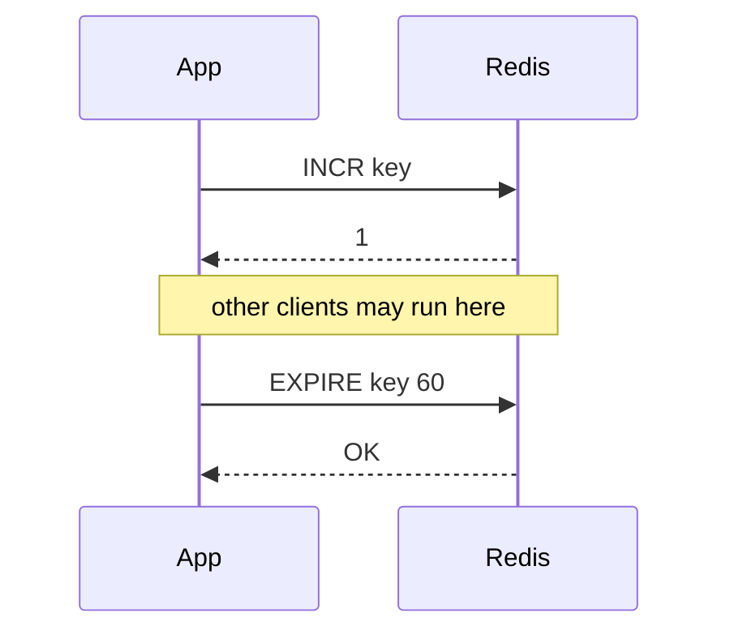
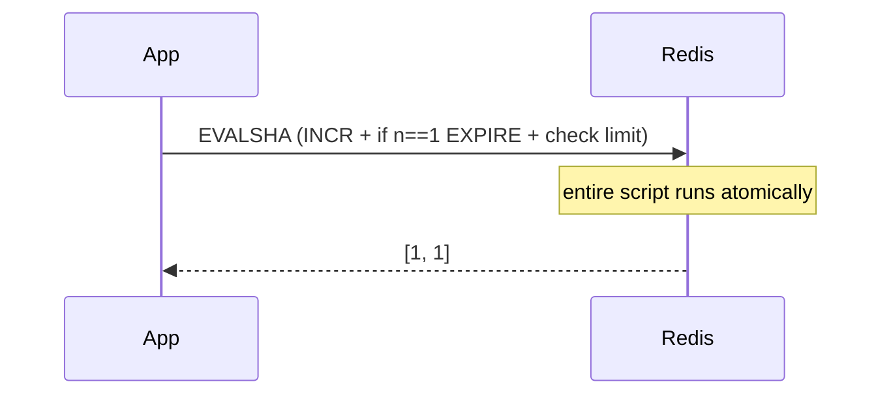

# Redis Lua scripts (`EVAL` / `EVALSHA`)

How server-side Lua runs in Redis, and when to use it in Module 5 (rate limiting, atomicity). Complements [`rate-limit-approaches-and-failures.md`](rate-limit-approaches-and-failures.md) and [`lab_5_rate_limit.py`](lab_5_rate_limit.py) modes `a-lua` / `b-lua`.

---

## What it is

You send a **short Lua program** to Redis. Redis runs it **on the main thread** and returns a result. The script calls Redis with **`redis.call('COMMAND', …)`** — it is not general-purpose Lua (no filesystem, no sockets).

```text
Client                         Redis (single thread)
  |                                  |
  |  EVALSHA <sha> 1 key w limit     |
  |------------------------------->  |
  |                                  |  run script start→end
  |                                  |  (no other commands interleave)
  |  reply e.g. [1, 3]               |
  |<-------------------------------  |
```

**Lab example** (`--mode a-lua`):

```lua
local n = redis.call('INCR', KEYS[1])
if n == 1 then
  redis.call('EXPIRE', KEYS[1], tonumber(ARGV[1]))
end
if n > tonumber(ARGV[2]) then
  return {0, n}
end
return {1, n}
```

```text
EVALSHA <sha> 1 m5:rl:<digest> 60 5
         │      │       │         │  └─ ARGV[2] limit
         │      │       │         └──── ARGV[1] window seconds
         │      │       └────────────── KEYS[1]
         │      └────────────────────── numkeys
         └───────────────────────────── script digest (from SCRIPT LOAD)
```

---

## Execution model

### 1. Atomic with respect to other clients

While a script runs, Redis does **not** execute other clients’ commands on that instance. Your `INCR` + conditional `EXPIRE` + branch logic happen as **one uninterrupted chunk** from everyone else’s point of view.

That is different from **pipeline** (batch RTT) or **multiple Python round trips**, where other clients can run between your commands.

### 2. Not a rollback transaction

If command 3 in the script fails, commands 1–2 that already ran **stay applied**. Redis does **not** undo earlier `redis.call` results inside the script (same spirit as `MULTI`/`EXEC` — no SQL-style `ROLLBACK`).

Example:

```lua
redis.call('INCR', KEYS[1])   -- applied
redis.call('EXPIRE', KEYS[1], 'not-a-number')  -- error → script aborts
-- INCR is NOT reverted
```

### 3. Single-threaded server

Commands are still executed **one at a time** on one Redis process. Lua does not make Redis multi-threaded; it **groups** your steps so no **other** client slips between them.

### 4. `redis.call` vs `redis.pcall`

| API | On Redis command error |
|-----|-------------------------|
| `redis.call` | Script **stops**; client gets error; prior calls in script **not** rolled back |
| `redis.pcall` | Error returned as Lua value; you can branch (advanced) |

Lab scripts use `redis.call`.

---

## `KEYS`, `ARGV`, and `EVAL` syntax

```text
EVAL <script> <numkeys> <key1> … <keyN> <arg1> … <argM>
```

| In Lua | Meaning |
|--------|---------|
| `KEYS[1]` … `KEYS[N]` | First `numkeys` arguments after `numkeys` |
| `ARGV[1]` … | Remaining arguments (strings; use `tonumber`) |

**Why distinguish keys:** In **Redis Cluster**, all keys touched in a script must live in the **same hash slot**. Marking keys explicitly helps Redis enforce that (single-instance Docker lab: one key is fine).

**From Python (redis-py):**

```python
sha = client.script_load(script_body)
client.evalsha(sha, 1, redis_key, window_seconds, limit)
```

---

## `SCRIPT LOAD` and `EVALSHA`

| Command | Purpose |
|---------|---------|
| `SCRIPT LOAD <body>` | Store script on server; returns **SHA1** digest |
| `EVALSHA <sha> …` | Run cached script by digest (less bandwidth than `EVAL` every time) |
| `EVAL <body> …` | Run script text inline (fine for experiments) |

After **Redis restart**, scripts are gone → `EVALSHA` returns **`NOSCRIPT`**. Reload with `SCRIPT LOAD` or use `EVAL` once. [`lab_5_rate_limit.py`](lab_5_rate_limit.py) caches SHA in process and loads on first use.

---

## Sequence: Lua vs Python Approach A

**Python (`--mode a`)** — two steps, gap possible:



**Lua (`--mode a-lua`)** — one trip, no interleaving inside script:



---

## Pros and cons

### Pros

| Benefit | Module 5 example |
|---------|------------------|
| **Atomic multi-step logic** | `INCR` + `EXPIRE` only when `n == 1` without another client in the middle |
| **Branching on Redis state** | `if n == 1 then …` — not possible in plain `MULTI`/`EXEC` without fixed command list |
| **Fewer round trips** | One `EVALSHA` vs `TTL` + `SET` + `INCR` (Approach B) |
| **Less app-side race** | No “crash between `INCR` and `EXPIRE`” across **two** network hops (still no rollback if script errors mid-way) |
| **Server-side efficiency** | Less chatty than many small commands from the app |

### Cons

| Drawback | What it means |
|----------|----------------|
| **No rollback** | Failed later `redis.call` does not undo earlier ones in the same script |
| **Harder to test and read** | Logic split between Python and Lua; version/deploy scripts explicitly |
| **Debugging** | Errors are script line + Redis error; use `redis-cli SCRIPT DEBUG` only when needed |
| **Operational limits** | Scripts should stay **short**; long CPU-heavy scripts block the whole instance |
| **Cluster rules** | All `KEYS` must share a slot; multi-key patterns need design (not your single-key lab) |
| **Retry = double execution** | Client timeout + retry can run the script **twice** → two `INCR`s unless you add idempotency tokens |
| **Replication** | Replicas apply **effects** of commands; understand replay on failover (awareness for production) |
| **Portability** | Team must maintain Lua; not as obvious as `INCR` in application code |

---

## When Lua fits Module 5

| Use Lua | Prefer plain commands / Python |
|---------|--------------------------------|
| Conditional `EXPIRE` after `INCR` (Approach A) | Single `INCR` or `SET NX` only |
| `TTL` / `SET` / `INCR` in one unit (Approach B) | Prototype read in CLI first |
| Strict cap without over-count (stretch: `DECR` on deny) | Simple lab counter where deny still `INCR`s |
| Hot path, many RTTs today | One-command operations |

---

## Limits and good habits (lab → production awareness)

- Keep scripts **small** and deterministic (no random, no time unless you accept test flakiness).
- Pass **limit** and **window** as `ARGV`, not hard-coded, so one script serves all keys.
- Use **`EVALSHA`** after `SCRIPT LOAD` in long-running apps.
- Document **deny semantics**: current lab Lua still **increments on deny** (`n > limit` after `INCR`); changing that requires different Lua (see failure-modes doc).
- After Redis upgrade/restart, handle **`NOSCRIPT`** (reload script).

---

## Related files

| File | Role |
|------|------|
| [`lab_5_rate_limit.py`](lab_5_rate_limit.py) | `LUA_APPROACH_A`, `LUA_APPROACH_B`, `--mode a-lua` / `b-lua` |
| [`rate-limit-approaches-and-failures.md`](rate-limit-approaches-and-failures.md) | Fixed window A/B, optimizing A with Lua |
| [Redis docs: Scripting](https://redis.io/docs/latest/develop/programmability/eval-intro/) | Official reference |

---

## One-line summary

**Lua runs your logic on Redis in one atomic slice (vs other clients), in one round trip, with branching — but without automatic rollback and with ops/retry/cluster caveats.**
