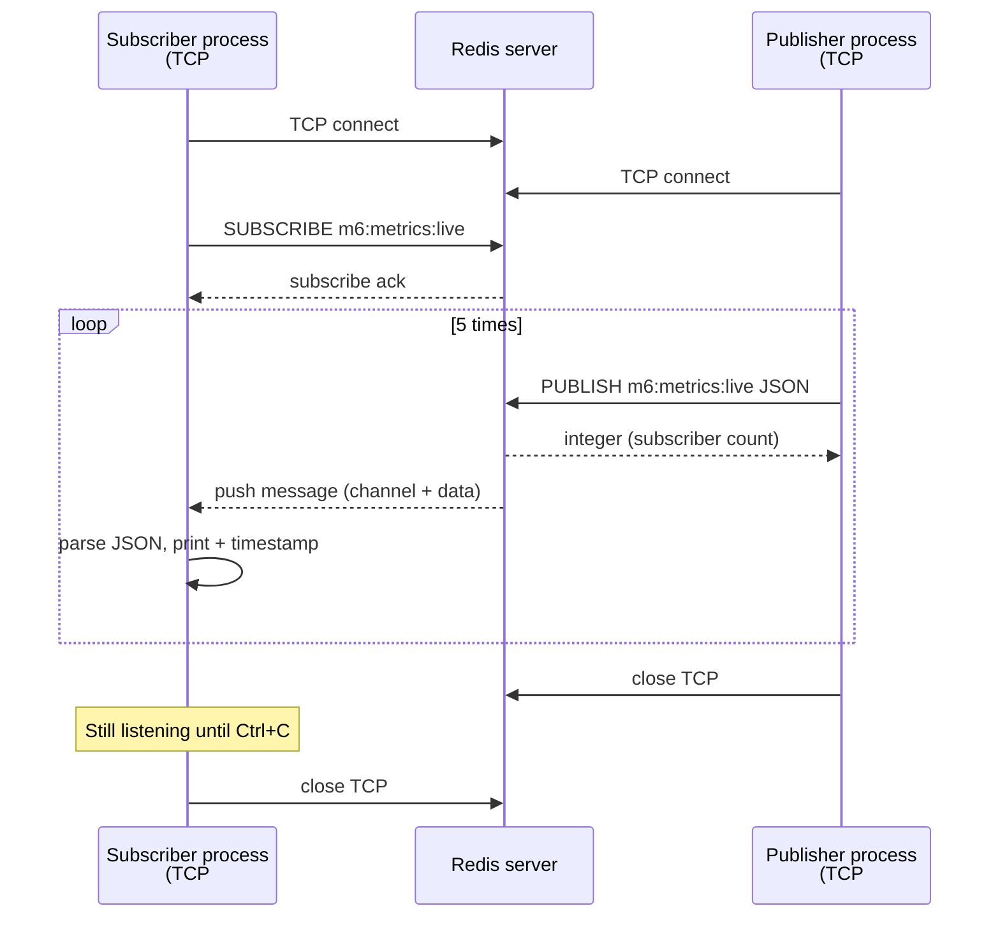

# Redis Pub/Sub — publisher, subscriber, and networking

Companion to **Module 6 warm-up B** (`lab_6a_pubsub.py`) and channel `m6:metrics:live`.

This is **not** a cache pattern. Pub/Sub **signals** and **fans out** live events; it does **not** store messages for later `GET`.

---

## Pattern at a glance

| Role | Responsibility | Redis commands |
|------|----------------|----------------|
| **Publisher** | Send a payload to a **channel name** | `PUBLISH channel message` |
| **Subscriber** | Register interest; receive pushes | `SUBSCRIBE channel` (or `PSUBSCRIBE pattern`) |
| **Broker (Redis)** | Map channels → connected clients; route each publish | Internal subscriber tables |

Publishers do not need a list of subscriber addresses. Subscribers do not poll Redis for “new data” on a key.

---

## Two processes, two TCP connections

In the lab you run **two terminals** (or two processes). Each Python client opens its **own** TCP connection to Redis (default `localhost:6379`).

```text
  Terminal 1                         Redis                         Terminal 2
  (subscriber)                       :6379                         (publisher)
       |                               |                               |
       |======== TCP connection #2 ====|                               |
       |  SUBSCRIBE m6:metrics:live    |                               |
       |  (long-lived, read loop)      |                               |
       |                               |======= TCP connection #1 =====|
       |                               |  PUBLISH ... (5x, then exit)  |
       |                               |                               |
       |<---------- push "message" -----|  (one push per PUBLISH)       |
```

**Important:** `SUBSCRIBE` does **not** create TCP. **Connecting** to Redis creates TCP. `SUBSCRIBE` only changes how **that** connection is used.

---

## Lifecycle: subscriber first

Pub/Sub is **live only**. If no connection is subscribed when `PUBLISH` runs, the message is not queued for a later subscriber.

**Correct order for the lab:**

1. Start `python lab_6a_pubsub.py subscribe` (TCP #2 + `SUBSCRIBE`).
2. Wait until subscribed (script prints confirmation).
3. Run `python lab_6a_pubsub.py publish` (TCP #1, five `PUBLISH`, then exit).

If the publisher prints `subscribers=0`, nothing was listening yet.

---

## What happens on each connection

### Subscriber connection (push / read mode)

1. Client **connects** → TCP established.
2. Client sends **`SUBSCRIBE m6:metrics:live`**.
3. Redis adds this socket to the channel’s subscriber set and sends a **subscribe** acknowledgment.
4. The client **blocks reading** the socket (`listen()` or `get_message()` in redis-py).
5. When any client **`PUBLISH`**es to that channel, Redis **writes** a **message** push to this socket **without** the subscriber sending a new command.
6. On **Ctrl+C**, unsubscribe / close pubsub and close the client → TCP closes.

After step 2, that connection should **not** be reused for normal commands (`GET`, `SET`, `PUBLISH`) in the same process. Use a **second client** for publishing (as the lab does across two processes).

### Publisher connection (request / reply mode)

1. Client **connects** → TCP established (**once** per run).
2. For each metric: send **`PUBLISH m6:metrics:live <json string>`**.
3. Redis fans out to all subscribers on that channel.
4. Redis **replies on the same TCP connection** with an **integer**: how many subscribers received the push (e.g. `1`).
5. After five publishes, **close** the client → TCP closes.

**One TCP connection, many publishes** — not one new TCP connection per `PUBLISH`.

```text
connect ──► PUBLISH ──► PUBLISH ──► … ──► close
            └──────── one TCP connection ────────┘
```

---

## Sequence diagram (happy path)



---

## Push vs pull (networking idea)

| Style | Who drives delivery | Pub/Sub example |
|-------|---------------------|-----------------|
| **Pull** | Client repeatedly asks | `GET` cache key; HTTP polling |
| **Push** | Server sends when event happens | After `SUBSCRIBE`, Redis pushes `message` events |

The subscriber’s TCP connection is mostly **idle waiting for reads** — classic **long-lived connection** + **server push**, not “send a request per notification.”

The publisher still uses **pull-shaped** command/reply: it **sends** each `PUBLISH` and **reads** the integer reply.

---

## How does the subscriber know without polling?

**“No polling”** means the app does **not** repeatedly ask Redis “anything new?” with new commands (e.g. `GET` or a fake check in a loop with `sleep`). After **`SUBSCRIBE`**, notifications arrive because Redis **pushes** data on the **same TCP connection**.

### Application polling (what Pub/Sub avoids)

```text
loop forever:
  sleep 1 second
  send some Redis command to check for updates
  often get nothing — wasted work and latency
```

### Pub/Sub (one registration, then wait)

```text
once: SUBSCRIBE m6:metrics:live
then: block reading this connection until Redis sends bytes
```

No new Redis command per notification — only the initial `SUBSCRIBE` (and later `UNSUBSCRIBE` / disconnect).

### Step by step when someone PUBLISHes

1. Redis looks up subscribers for the channel (including your socket).
2. Redis **writes** a Pub/Sub **message** frame to your connection’s outbound buffer.
3. That becomes **TCP data** to your machine (into the kernel’s receive buffer for your socket).
4. Your process is blocked in a **read** on that socket (inside redis-py `listen()` or `get_message()`).
5. When bytes arrive, the kernel **unblocks** the read; the client parses one event → your loop handles it.

```text
Publisher --PUBLISH--> Redis --push on subscriber TCP--> kernel buffer --> read() wakes up
```

The subscriber “knows” because **data arrived on an already-subscribed socket**, not because it issued another command.

### Is `listen()` still “polling”?

At the **socket** level, the library waits until the connection is **readable** (blocking read, or `select` / `epoll` / `kqueue`). That is **not** the same as **polling Redis**:

| | App polling Redis | Pub/Sub + blocking read |
|--|-------------------|-------------------------|
| New Redis command each check? | Yes | No (after `SUBSCRIBE`) |
| Who initiates the payload? | You keep asking | Redis pushes on each `PUBLISH` |
| Traffic when idle | Repeated requests | One open connection, quiet until a publish |

From your application’s perspective, the model is **event-driven**: your handler runs when a **`message`** event is parsed.

### Lab tie-in

```python
for message in pubsub.listen():  # blocks until Redis pushes something
    if message["type"] != "message":
        continue
    ...
```

If nobody publishes, the subscriber **waits** (no spin loop, no periodic Redis checks). It wakes when Redis sends the next push (or a control message such as unsubscribe).

**One line:** The subscriber does not poll the channel; it **blocks reading one TCP connection** until Redis **pushes** a notification because a **`PUBLISH`** happened.

---

## Messages: sequential, not batched

- Each **`PUBLISH`** produces **one** Pub/Sub **message** event per subscriber (one channel payload).
- Redis processes commands **serially** on the main thread; subscribers usually see publishes in **order** on a given channel.
- The OS may **batch TCP bytes** on the wire; redis-py still exposes **one parsed event** per `listen()` yield / `get_message()` call.
- Redis Pub/Sub does **not** merge five publishes into one application-level “batch message” unless **you** put an array inside a single JSON payload in one `PUBLISH`.

Control frames (e.g. `subscribe`) appear before `message` types — filter on `type == "message"` in application code.

---

## Fan-out and backpressure

One `PUBLISH` → **N** subscribers means **N outbound writes** (one per subscribed connection) plus one reply to the publisher.

If a subscriber is **slow** (paused debugger, overloaded CPU), its **socket receive buffer** can fill. TCP **backpressure** slows the sender side. Pub/Sub does **not** give you a durable queue on the channel for that slow client — operational fixes include disconnecting, using **Streams**, or an external queue.

---

## Delivery semantics (what Redis does *not* guarantee)

Treat classic Redis Pub/Sub as **ephemeral, at-most-once live fan-out**:

| Situation | Result |
|-----------|--------|
| Subscriber offline during publishes | **Missed** messages (no replay) |
| Late subscriber | Only sees publishes **after** `SUBSCRIBE` |
| Need “every payment event forever” | Use **DB**, **Streams**, or a message queue — not Pub/Sub alone |

Caching (Modules 1–5) holds **state** with TTL; Pub/Sub **notifies** listeners **now**.

---

## Compared to cache keys

| | Cache (`SET` / `GET`) | Pub/Sub |
|--|----------------------|---------|
| Storage | Value kept until TTL/`DEL` | No channel backlog |
| Late client | `GET` returns last value | No history on subscribe |
| Typical use | Read path, shared state | Live updates, cache-bust signals |

Common production combo: update cache or DB, then **`PUBLISH`** so other app instances invalidate or refresh.

---

## Lab commands (reference)

```bash
# Terminal 1
python labs/module-6-beyond-cache/lab_6a_pubsub.py subscribe

# Terminal 2
python labs/module-6-beyond-cache/lab_6a_pubsub.py publish
```

Environment: `REDIS_URL` (default `redis://localhost:6379/0`), Docker service `caching-redis`.

---

## Further reading in this path

- **Streams** (`XADD`, `XREAD`) — append-only log with replay; see Lab 6B in `README.md`.
- **Module 6 checkpoint** — Pub/Sub vs Streams durability questions in `notes/module-6-checkpoint.md` (when you write it).
