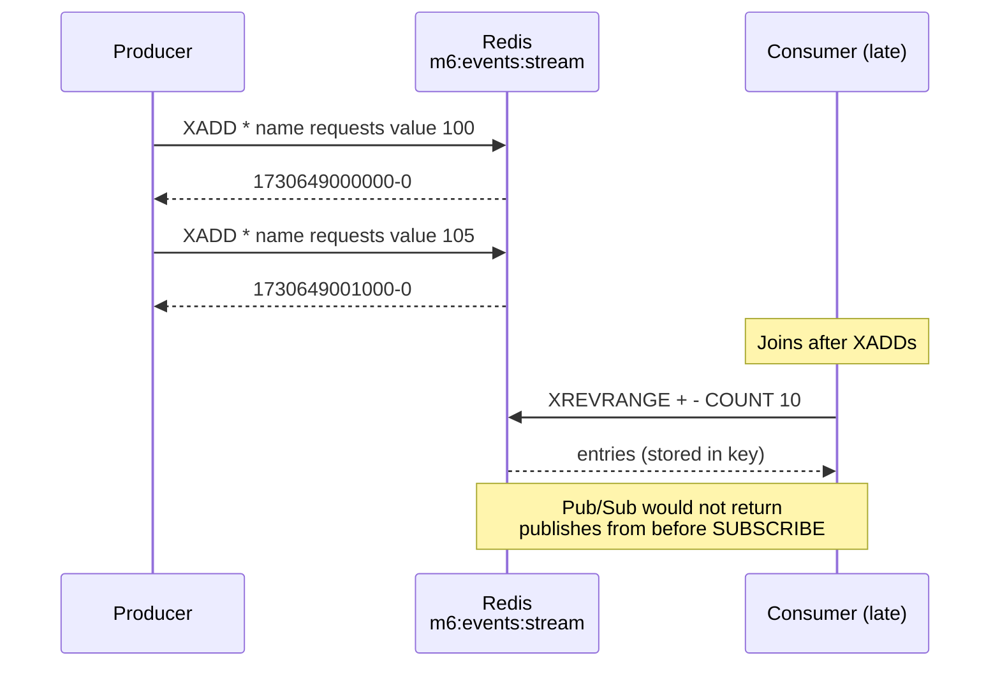
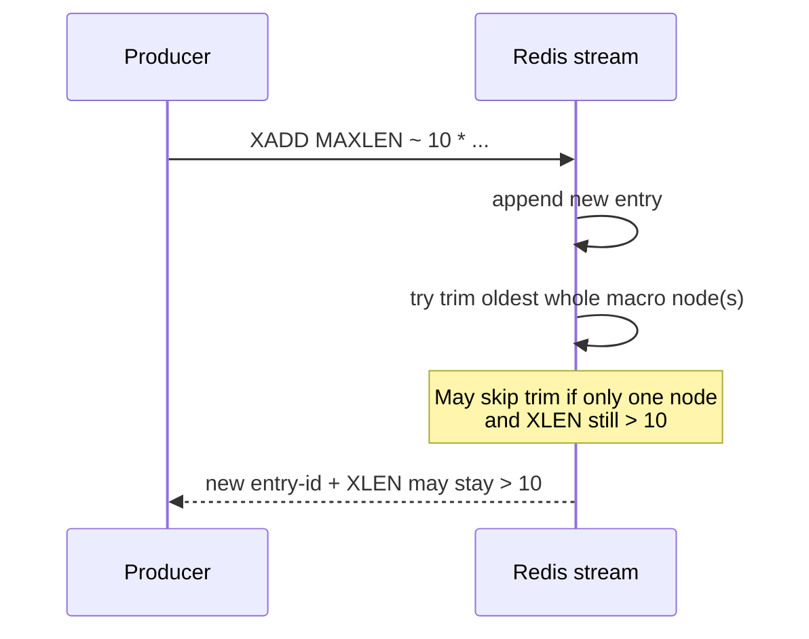
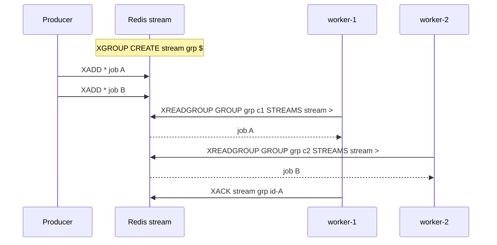

# Redis Streams — intro, commands, and flows

Companion to **Lab 6B** (`lab_6b_streams.py`) and contrast with **Pub/Sub** (`pubsub-publisher-subscriber.md`).

A **stream** is an append-only **event log** under one Redis key. Each **entry** has a unique **ID** and **field/value** pairs. Streams support **history**, **tail reads**, and optional **consumer groups**—unlike Pub/Sub, which is live fan-out with **no** channel backlog.

---

## When to use a stream

| Need | Pub/Sub | Stream |
|------|---------|--------|
| Notify all listeners **right now** | Strong fit | Optional (`XREAD BLOCK`) |
| **Late joiner** sees recent history | No (unless + list) | `XRANGE` / `XREVRANGE` |
| **Bounded** memory for metrics | Manual list trim | `XADD` + `MAXLEN` |
| **Several workers**, one message → one worker | Not this | Consumer groups + `XACK` |
| **Every dashboard** sees **every** event | `SUBSCRIBE` all | `XREAD` / `XREVRANGE` (no group) |

**Not a cache replacement:** streams hold **events over time**; cache-aside still uses `GET`/`HSET` + TTL for entity reads (see `notes/module-6-checkpoint.md`).

---

## Data model

```text
Key: m6:events:stream

  1730649000000-0  →  name=requests, value=100
  1730649001000-0  →  name=latency,  value=12
  1730649002000-0  →  name=requests, value=105
```

- **ID** — usually auto (`*` on `XADD`); time-ordered (`milliseconds-sequence`).
- **Fields** — flat key/value strings (e.g. `name`, `value`); not nested JSON unless you store one field as JSON text.
- **Order** — entries sort by ID; tail = newest.

---

## Commands reference

### `XADD` — append an entry

```text
XADD m6:events:stream * name requests value 42
XADD m6:events:stream MAXLEN ~ 10 * name requests value 43
XADD m6:events:stream MAXLEN 10 * name requests value 44
```

| Piece | Meaning |
|-------|---------|
| **`*`** | Auto-generate entry ID (not multiplication). |
| `name` / `value` | Field name and value pairs (repeat for more fields). |
| **`MAXLEN N`** | After append, trim so length ≤ **N** (**exact** trim). |
| **`MAXLEN ~ N`** | **Approximate** trim—see [Trimming](#trimming-maxlen-exact-vs-~). |

**redis-py (Lab 6B producer):**

```python
client.xadd("m6:events:stream", {"name": "requests", "value": "42"}, maxlen=10, approximate=True)
```

---

### `XRANGE` / `XREVRANGE` — read by ID range

```text
XRANGE m6:events:stream - +              # oldest → newest, all
XRANGE m6:events:stream - + COUNT 10     # first 10 from start
XREVRANGE m6:events:stream + - COUNT 10  # newest 10 (newest listed first)
```

| Command | Typical use |
|---------|-------------|
| **`XRANGE`** | Forward scan, full log, time/ID window |
| **`XREVRANGE`** | **Catch-up:** “last N” for late joiners |

---

### `XREAD` — read with cursor + optional block

```text
XREAD COUNT 10 BLOCK 5000 STREAMS m6:events:stream 0
XREAD COUNT 10 BLOCK 5000 STREAMS m6:events:stream 1730649002000-0
```

| Piece | Meaning |
|-------|---------|
| **Stream ID after key** | Return entries with ID **greater than** this ID. |
| **`0`** | From the beginning (no entries yet consumed in this tail loop). |
| **`$`** | Only entries added **after** this command (special “new only” cursor). |
| **`COUNT N`** | At most **N** entries **per call** (new entries after cursor—not “last N in entire stream”). |
| **`BLOCK ms`** | Wait up to **ms** milliseconds for new data; return early when entries arrive. |
| **`BLOCK 0`** | Block until data (check redis-py / Redis version behavior in your client). |

**Tail loop (Lab 6B consumer):** catch-up with `XREVRANGE`, set `last_id` to newest seen, then loop `XREAD` with that `last_id`, advance `last_id` after each batch.

**redis-py:** blocked reads may raise `redis.TimeoutError` on timeout—catch and loop (as in `lab_6b_streams.py`).

---

### `XLEN` — entry count

```text
XLEN m6:events:stream
```

Current number of entries in the stream (after trims).

---

### `XTRIM` — trim without appending

```text
XTRIM m6:events:stream MAXLEN 10
XTRIM m6:events:stream MAXLEN ~ 10
```

Same **exact** vs **`~`** semantics as `XADD` trimming.

---

### `DEL` — remove entire stream

```text
DEL m6:events:stream
```

Deletes the key and **all** entries.

---

### Consumer groups (stretch / production)

Not required for Lab 6B or “every dashboard reads all metrics.”

| Command | Role |
|---------|------|
| `XGROUP CREATE stream group $ MKSTREAM` | Create group; `$` = start from new entries |
| `XREADGROUP GROUP group consumer STREAMS stream >` | Claim **new** messages for this group (load-balance workers) |
| `XACK stream group id` | Mark processed; clear pending |
| `XAUTOCLAIM` / `XCLAIM` | Reclaim stale pending after worker crash |

**Groups** = parallel **workers** on one stream. **Without** groups, multiple dashboards each run their own `XREAD` cursor and all see every entry.

---

## Trimming: `MAXLEN` exact vs `~`

Streams are stored as a **radix tree** of **macro nodes** (many entries per node, often up to ~100 by default).

| Mode | Command shape | When trim runs | Effect |
|------|----------------|----------------|--------|
| **Exact** | `MAXLEN 10` | On each qualifying `XADD` / `XTRIM` | `XLEN` → **≤ 10** (trim individual entries) |
| **Approximate** | `MAXLEN ~ 10` | On each qualifying `XADD` / `XTRIM` | Removes only **whole oldest macro nodes** when rules allow |

**Why `XLEN` can be 15 with `~ 10`:** On a **small** stream, all entries may sit in **one** node. Approximate trimming may **not** delete that node without removing too much at once—so **no trim** happens until the structure allows whole-node deletion. Exact `MAXLEN 10` trims per entry.

**Lab implication:** use `approximate=False` in redis-py if you want a strict cap in demos; use `~` for throughput at scale and accept `XLEN ≥ N`.

---

## Lab 6B pattern (producer + consumer)

**Producer** (separate process): loop `XADD` + `MAXLEN ~ 10` with fields `name`, `value`.

**Consumer** (separate process):

1. **`XREVRANGE … COUNT 10`** — late join: last up to 10 entries; set `last_id` to **newest** (or `"0"` if empty).
2. Loop **`XREAD COUNT 10 BLOCK …`** with `last_id` — only **new** entries; update `last_id` after each message.

**Start order:** consumer may start before producer (unlike Pub/Sub). Empty catch-up + `last_id = "0"` is fine.

**Run:**

```bash
python labs/module-6-beyond-cache/lab_6b_streams.py consume
python labs/module-6-beyond-cache/lab_6b_streams.py produce
```

---

## Sequence diagrams

### 1. Append and stored history (vs Pub/Sub)



### 2. Catch-up + blocking tail (Lab 6B)

```mermaid
sequenceDiagram
    participant C as Consumer
    participant R as Redis stream
    participant P as Producer

    C->>R: XREVRANGE COUNT 10
    R-->>C: last N entries
    C->>C: last_id := newest ID (or 0)

    loop Live tail
        C->>R: XREAD COUNT 10 BLOCK 5000 STREAMS stream last_id
        alt New entries
            P->>R: XADD (optional during wait)
            R-->>C: 1–10 new entries
            C->>C: process; advance last_id
        else Timeout
            R-->>C: (empty)
            Note over C: loop again
        end
    end
```

### 3. `MAXLEN ~` on append (logical)



### 4. Consumer group (workers, not dashboards)



---

## Streams vs Pub/Sub + capped list (mini project)

| Approach | Live | Last N replay |
|----------|------|----------------|
| **Pub/Sub + list** | `PUBLISH` | `LPUSH` + `LTRIM` + `LRANGE` on join |
| **Streams only** | `XREAD BLOCK` tail | `XREVRANGE` on join |

One stream can replace **both** list history and Pub/Sub for metrics-style dashboards; Pub/Sub path in the README teaches **live-only limits** explicitly.

---

## Mental checklist

- **ID `*`** on `XADD` = server-generated ID.
- **`COUNT` on `XREAD`** = batch of **new** items after cursor, not “last N in stream” on every poll.
- **`BLOCK ms`** = wait for new entries, not a Redis key name.
- **Reads do not delete** entries; **`MAXLEN` / `XTRIM` / `DEL`** remove data.
- **`XACK`** does not delete stream entries—only consumer-group pending state.
- **Late joiner last N** does **not** require consumer groups.

---

## Further reading in this repo

- `pubsub-publisher-subscriber.md` — push vs pull, two TCP connections
- `notes/module-6-checkpoint.md` — checkpoint answers
- `README.md` — Lab 6B requirements, optional mini project `live-dashboard`
