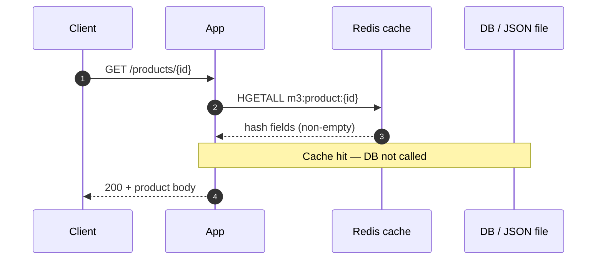
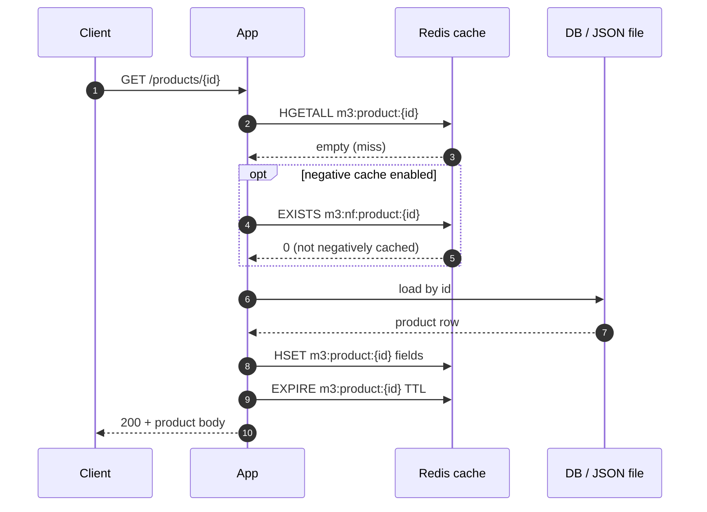
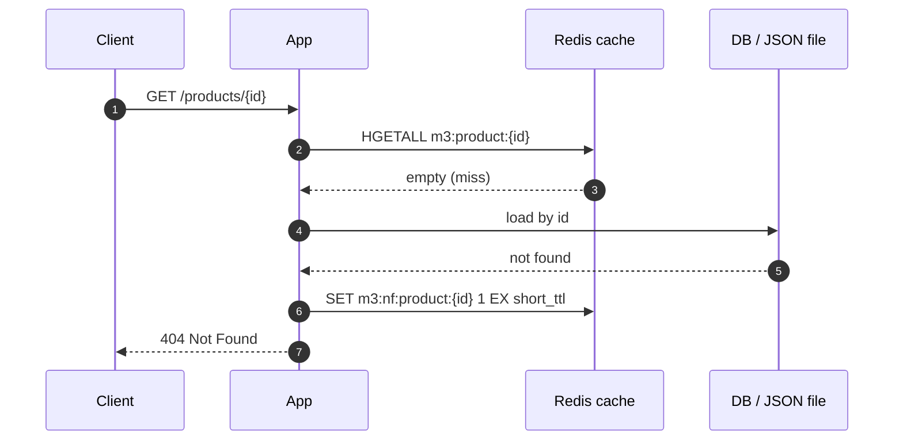
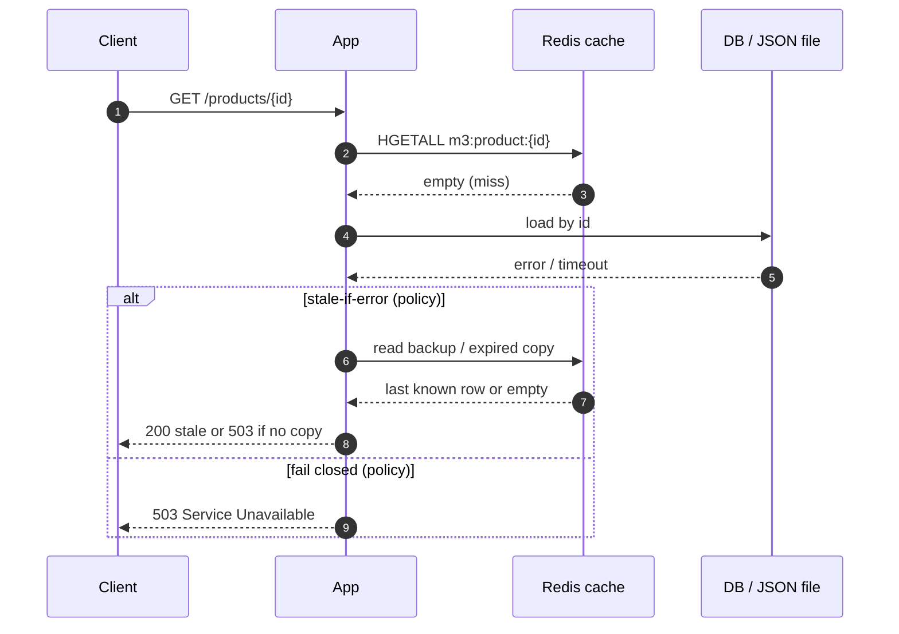

# Module 3 checkpoint — cache-aside, stampede, DB failure

## 1. Sequence diagrams (cache-aside reads)

Lab keys: product hash `m3:product:{id}`, optional negative `m3:nf:product:{id}`, lock `m3:lock:product:{id}` (Lab 3B).

### 1a. Cache hit



### 1b. Cache miss → load DB → populate cache



### 1c. Cache miss → product not found (optional negative cache)



### 1d. Cache miss → DB down (no fresh data)



### 1e. Cache hit when DB is down

```mermaid
sequenceDiagram
    autonumber
    participant Client
    participant App
    participant Redis as Redis cache
    participant DB as DB / JSON file

    Client->>App: GET /products/{id}
    App->>Redis: HGETALL m3:product:{id}
    Redis-->>App: hash fields (hit)
    Note over App,DB: DB may be down; hit still OK
    App-->>Client: 200 + product body
```

### Excalidraw (optional sketch)

[`labs/module-3-cache-aside/Cache Aside Diagram.excalidraw.png`](../labs/module-3-cache-aside/Cache%20Aside%20Diagram.excalidraw.png)

---

## 2. Read pattern (Lab 3A)

**Cache-aside (lazy loading).**

- On **hit:** app reads Redis only (`HGETALL m3:product:{id}` in our lab); no DB call.
- On **miss:** app loads from DB/file, then **app** populates cache (`HSET` + `EXPIRE`).

**Contrast — read-through:** the cache layer loads from the DB on miss and fills itself; the app is tightly coupled to “ask the cache” and does not own the miss path.

In cache-aside the **application has full control** of hit vs miss behavior (TTL, negative cache, stampede lock, fallbacks when DB fails).

**Design question (empty Redis, row in DB):** still cache-aside — first request is a miss; app reads DB and fills Redis.

---

## 3. Cache stampede (Lab 3B)

**What it is:** A hot key expires or is cold (e.g. `m3:product:101`). Many concurrent requests (often from multiple app instances) all **miss** at once and each tries to load the **same** row from the DB → duplicate work and risk of overwhelming the database.

**Evidence in lab:** unprotected runs show `JSON lookups` / `db_reads` ≫ 1; with `--protected`, `db_reads` ≈ 1. Wall time may look similar; the win is **fewer DB trips**, not always faster batch benchmarks.

### Mitigation: distributed lock + double-check

- **Product cache:** `m3:product:{id}` (hash).
- **Lock:** `m3:lock:product:{id}` — `SET … NX EX` (e.g. 10s TTL), separate from the product key.

**Flow on miss:**

1. `HGETALL` product key → empty.
2. Try `SET lock NX EX`. If **success (holder):**
   - **Double-check** `HGETALL` again (another worker may have filled cache).
   - If still miss → load DB/JSON → `HSET` + `EXPIRE` → `DEL` lock → return.
3. If **lock not acquired (waiter):** sleep briefly → retry `HGETALL`; loop until hit or timeout; optionally retry `SET NX` after lock TTL.

Lock TTL prevents deadlock if a worker crashes before `DEL`.

**Not the same as stampede fix:** in-process single-flight helps one process only; Redis lock coordinates across instances.

---

## 4. DB down — what does the app return?

| Scenario | Typical behavior |
|----------|------------------|
| **Cache hit** | Return cached product; DB down does not matter. |
| **Cache miss, DB up** | Load DB, fill cache, return (cache-aside). |
| **Cache miss, DB down** | No fresh authoritative data unless we planned a fallback → error or degraded/stale policy. |

### Fallback strategies (miss + DB unavailable)

1. **Stale-if-error / serve stale** — keep or extend last good value; on DB failure after miss, return stale with a header or max-staleness rule. Good for low-risk catalog copy; risky for price/stock without policy.
2. **Circuit breaker** — track DB failures; when **open**, skip DB calls on miss (fail fast). Use stale cache, degraded payload, or **503** + `Retry-After`. **Half-open** probes when cooldown ends. Prevents retry storms and pool exhaustion; complements cache-aside (hits still fast).
3. **Degraded response** — partial JSON (“price unavailable”) instead of full lie.
4. **Fail closed** — **503/504** when stale or fake data is unacceptable (checkout, inventory).
5. **Negative cache** — only helps known-missing ids without DB; does not load new products when DB is down.

**Lab 3A today:** hit/miss/negative-cache only; no DB-down simulation unless we add it later.

---

## 5. Bridge to Module 4

Reads are cache-aside; **writes** (price update, stock) need **invalidation (`DEL`) or cache update (`HSET`)** and consistency choices — Module 4.

---

Module 3 complete → **Module 4** (write patterns & invalidation).
