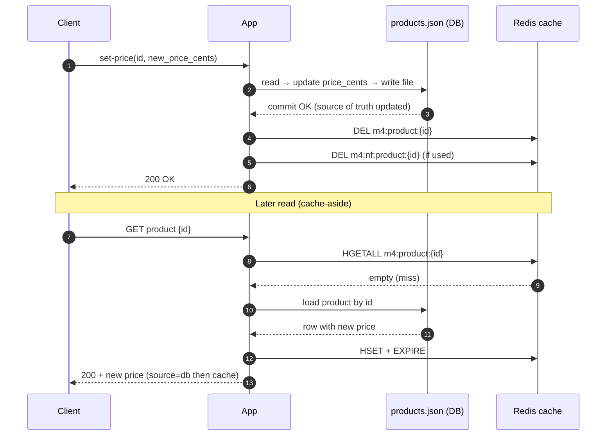
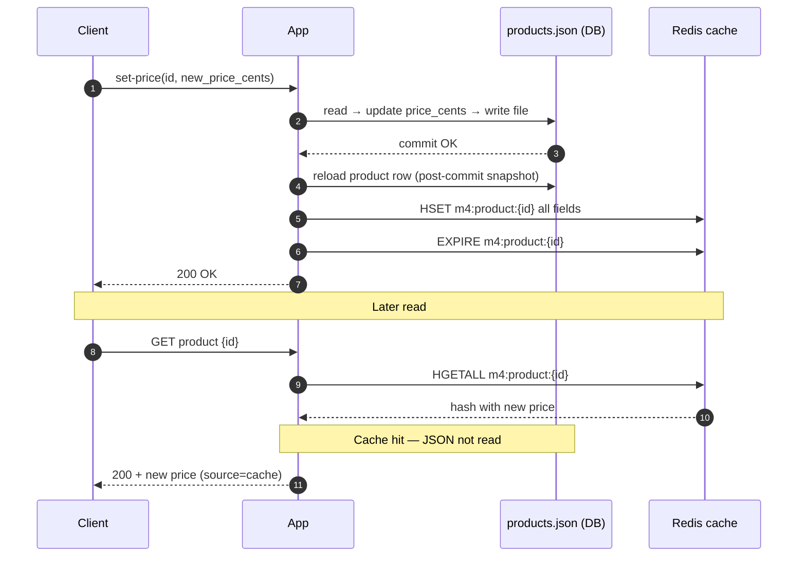

# Module 4 checkpoint — write patterns & consistency

Lab keys: product hash `m4:product:{id}`, negative `m4:nf:product:{id}`, queue `m4:write-queue`. Mock DB: `labs/module-3-cache-aside/data/products.json`.

---

## 1. Sequence diagrams — write after DB commit (Lab 4A)

### 1a. Invalidate (DB first, then `DEL` cache)

### 1b. Update (DB first, then full hash refresh in cache)

**Terminology:** **Invalidate** on write is often **write-invalidate** (cache-aside write path). **Update** with full `HSET` after commit is the Lab 4A slice closest to **write-through** for that cache entry.

---

## 2. Write-through vs write-behind (labs)

### Write-through / synchronous write (Lab 4A)

The app updates **JSON/DB first**. After a successful commit:

- **Invalidate (`--mode invalidate`):** `DEL` cache keys; the next `get` is a miss, loads from JSON, repopulates Redis with TTL.
- **Update (`--mode update`):** `HSET` **all** cached fields from the post-commit product + `EXPIRE`; the next `get` can be a **cache hit** without reading JSON.

Reads remain **cache-aside** in both cases.

### Write-behind (Lab 4B — Variant C)

The app **`LPUSH`** a job to **`m4:write-queue`** and returns before JSON is updated. A **background worker** **`BRPOP`**s jobs, writes JSON, then **`DEL`** cache keys so the next miss loads fresh data from disk.

Until the worker finishes, **JSON** and a **warm cache** can still serve **stale** prices even though the API already accepted the enqueue. Demo: `scripts/demo-4b-enqueue-then-get.sh` with `worker --demo-delay`.

---

## 3. Bugs and failure modes — `update` (4A) vs write-behind (4B)

### Lab 4A — `--mode update` (sync cache refresh)

| Bug | What goes wrong | Mitigation in lab |
|-----|-----------------|-------------------|
| **Partial hash** | Only `HSET price_cents` when the key was missing → `HGETALL` is non-empty → **cache hit** with missing `name`, `sku`, etc. | After DB commit, **`HSET` all fields** from the post-commit product (or skip Redis if key absent). |
| **Partial staleness** | Key exists; only price patched but another field changed in JSON elsewhere → cache serves **mixed** old/new fields. | Prefer **invalidate** when many fields or unknown deltas; or always refresh **full** hash from DB snapshot. |
| **DB ok, Redis fail** | JSON has new price; `HSET`/`EXPIRE` fails → client may still get 200 on write, but cache stays **old** until TTL. | Retry cache write, alert, or **invalidate** on failure; document “eventual” cache coherence. |

### Lab 4B — write-behind + cache-aside reads (enqueue only; worker invalidates after JSON)

Our 4B path does **not** update the product hash on enqueue (Variant C). These are the bugs we actually hit or simulated:

| Bug | What goes wrong | When you see it |
|-----|-----------------|-----------------|
| **Stale cache hit** | Warm `m4:product:{id}` still has old price after `enqueue-price`; worker has not `DEL` yet. | Immediate `get` → `source=cache`, wrong `price_cents` (demo script). |
| **Stale miss → long-lived wrong cache** | Queue has new price but JSON still old; `get` **misses**, loads JSON, **`HSET` + TTL** → caches **old** data for the whole TTL. | Enqueue with empty/evicted cache, or after invalidate of wrong key only. |
| **Logical lag** | API success means **job queued**, not **JSON updated**; readers trust cache/JSON as if write completed. | Any read between enqueue and worker flush. |
| **Lost job** | Worker `BRPOP` then crash before JSON write → job gone, DB never updated. | At-most-once queue (lab sketch). |
| **Concurrent JSON access** | Worker writes file while another `get` reads JSON → rare torn read / lost update without atomic file replace. | Multiple writers or read-during-write on `products.json`. |

### If you combined write-behind with **update cache on enqueue** (not Lab 4B default)

Some designs `HSET` the cache when enqueueing (fast reads). Extra bugs on top of the table above:

| Bug | What goes wrong |
|-----|-------------------|
| **Cache ahead of DB** | Redis shows new price; JSON still old until worker runs → **DB is not source of truth** for reads that hit cache. |
| **Enqueue/cache ordering** | Cache updated but `LPUSH` fails → cache new, queue never persisted. |
| **Partial hash** | Same as 4A if enqueue only patches `price_cents` on a cold key. |
| **Fights worker `DEL`** | Cache updated on enqueue; worker later `DEL`s → brief confusion; if worker never runs, cache can be **newer** than JSON indefinitely. |

**Lab 4B choice:** enqueue only + worker updates JSON then **`DEL`** avoids optimistic cache update but **does not** remove stale **hits** until invalidation runs.

---

## 4. When is write-behind dangerous without durability guarantees?

Write-behind is dangerous when the **queue is not durable** and the API has already acknowledged the write:

1. **Redis loss without persistence** — If Redis restarts or fails and the queue was only in memory (no AOF/RDB or external durable queue), **jobs never reach the DB** even though clients got success.
2. **Worker crash after `BRPOP`** — The job is removed from the list but JSON was not flushed yet (**at-most-once** in the lab sketch); the write is **lost** unless you use a processing list, retries, or idempotency.

Durability of the **queue** and **worker processing** are part of the consistency story—not just the HTTP response.
